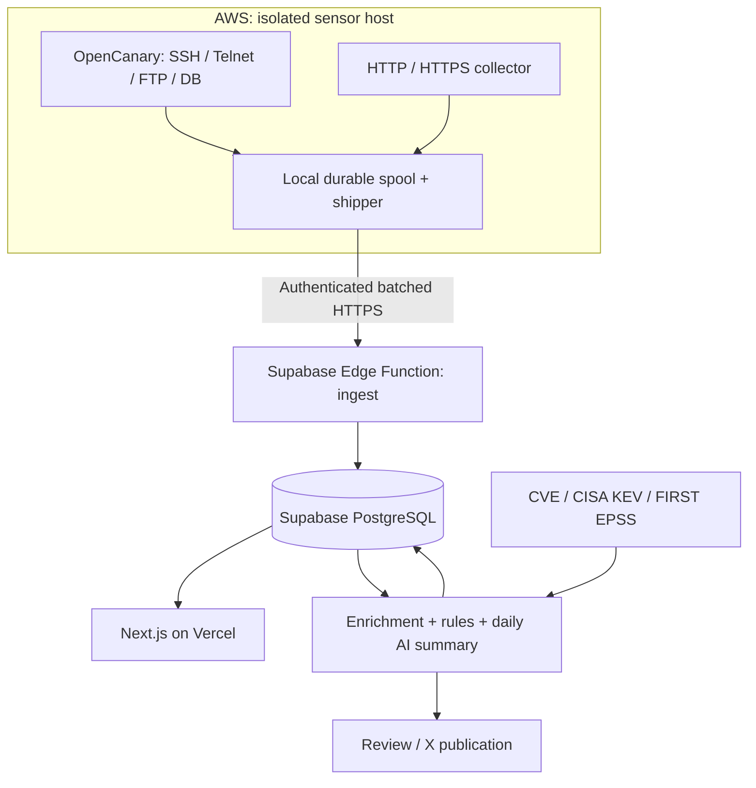

# Honeypot Observatory

OpenCanary を中心に、インターネット上の攻撃を観測・蓄積・分析し、
CVE / CISA KEV / EPSS と関連付けて公開する非商用の攻撃観測サイト。

> **Status:** Architecture / implementation planning. **No public honeypot is deployed.**
> This repository currently contains design documents and directory placeholders, not running services.

## Goals

- SSH / Telnet / FTP / DB の試行を OpenCanary で収集する。
- HTTP / HTTPS のスキャン・リクエストを軽量 Web センサーで収集する。
- 履歴・日次集計を PostgreSQL に蓄積し、公開ダッシュボードで時系列表示する。
- ルールによる攻撃パターン検出結果を、CVE / KEV / EPSS 情報で補足する。
- 匿名化・集計した観測データから AI で日次レポートを作り、人間の確認後に X に投稿する。

## Architecture



## Repository layout

```text
apps/web/                    Next.js dashboard (to implement)
AGENTS.md                    Cursor/AI agent repository-wide guardrails
sensors/opencanary/          OpenCanary config and deployment (to implement)
sensors/http-collector/      Minimal HTTP/HTTPS capture sensor (to implement)
sensors/shipper/             Bounded spool and authenticated log shipping (to implement)
supabase/functions/ingest/   Validated ingestion API (to implement)
supabase/migrations/         PostgreSQL schema / RLS / indexes (to implement)
jobs/                        Enrichment, aggregation, reporting (to implement)
infra/                       Infrastructure as code and operations (to implement)
docs/ARCHITECTURE.md         Components, data flow, deployments
docs/IMPLEMENTATION_PLAN.md  MVP scope, milestones, acceptance criteria
docs/CURSOR_SETUP.md         Official Vercel/Supabase Skills for Cursor
docs/DATA_MODEL.md           Tables and data lifecycle
docs/SECURITY.md             Threat model and operational safeguards
docs/DECISIONS.md            Architecture decision log
```

## Next steps

1. Confirm AWS account/region, hosting policy and the sensor host choice (**Lightsail subject to AWS confirmation; otherwise an approved EC2 configuration**).
2. Implement schema migrations and the ingest Edge Function, using synthetic test events.
3. Implement the dashboard against test data before exposing the sensor.
4. Deploy the isolated sensors only after security and abuse-response checks pass.
5. Add correlation, daily reporting, and manually reviewed X publication.

## Documents

- [Implementation plan](docs/IMPLEMENTATION_PLAN.md)
- [Architecture](docs/ARCHITECTURE.md)
- [Data model](docs/DATA_MODEL.md)
- [Security and deployment gates](docs/SECURITY.md)
- [Architecture decisions](docs/DECISIONS.md)
- [Cursor setup and recommended Skills](docs/CURSOR_SETUP.md)

## License

Undecided. Do not assume this repository or its data is licensed for third-party reuse until a license is selected.
