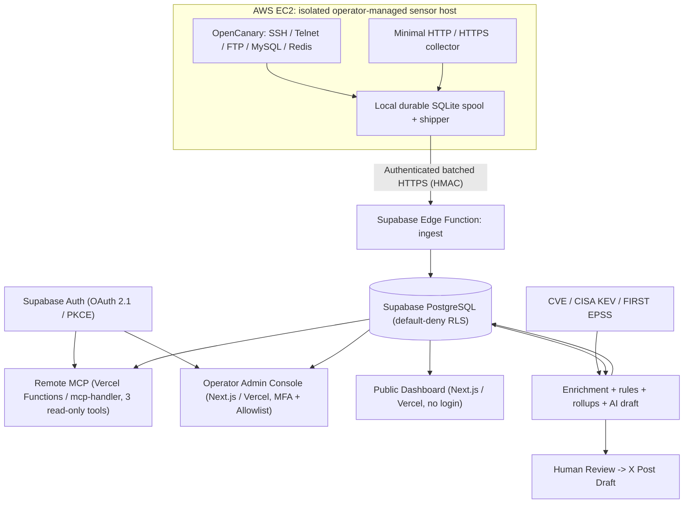

# Attackarium — Honeypot Observatory

A noncommercial threat-observability service that captures unsolicited Internet
probes and attack attempts on operator-managed honeypots, stores historical
observations over time, and publishes sanitized trends via a public Next.js
dashboard and an authenticated, read-only Remote MCP server.

**Attackarium is not a vulnerability database.** Original honeypot observations
are the primary dataset; CVE, CISA KEV, and FIRST EPSS provide supporting context
to help interpret observed patterns without claiming confirmed exploitation.

> **Status:** Phase 1 MVP foundation is on `main`. Initial AWS region is
> **US East (N. Virginia), `us-east-1`**.
> **No AWS resources, hosted database, or public honeypot are deployed yet.**
> Deployment awaits the remaining Phase 0 items and explicit owner approval.

## Product principles

- **Operator-managed sensors only:** Sensors are deployed and managed exclusively
  by Attackarium operators on **AWS EC2 in `us-east-1` (N. Virginia)** (user-contributed sensors such as the
  GreyNoise Project Swarm model are out of scope).
- **Public dashboard without login:** General viewers can inspect sanitized
  observations, 30-day trends, protocol/pattern breakdowns, and sensor health
  without creating an account.
- **Read-only Remote MCP on Vercel Functions:** Authenticated and explicitly
  entitled users (Google/GitHub via Supabase Auth OAuth 2.1 + PKCE) can query
  aggregated observations through 3 read-only tools (`get_attack_trends`,
  `get_attack_patterns`, `get_observation_summary`). No general-purpose public
  REST API is provided.
- **Operator-only Admin Console & MCP Usage:** Protected by server-side admin ID
  allowlist, mandatory MFA (`aal2`), and append-only audit logging.
- **Data minimization & honest interpretation:** Default-deny RLS, sanitized
  `security_barrier` views, hashed source IPs (plaintext cleared by default),
  explicit separation of zero-observation periods vs. sensor outage gaps, and
  mandatory human review for AI-drafted daily analysis and X posts.

## Architecture



## MVP roadmap

- **Phase 0 — Policy & Pre-Deployment Gate:** Region, host shape, 40 USD
  budget, abuse contact, runbook, retention, and MIT license are decided.
  Creating AWS resources still needs explicit approval.
- **Phase 1 — Observation Platform MVP (Top Priority):** Reliably collect,
  ingest, aggregate, and display original observations for **at least 30 days**
  with clear distinction between zero-traffic windows and sensor collection gaps.
- **Phase 2 — Public Service MVP:** Add evidence-backed CVE/KEV/EPSS context,
  OAuth 2.1 Remote MCP (3 read-only tools), operator-only Admin Console & MCP
  Usage, and human-reviewed AI daily analysis + X post drafts.
- **Evaluation — 30-Day Value Validation:** Assess real findings, temporal shifts,
  and dashboard/MCP usefulness honestly without arbitrary event-count targets.

## Repository layout

```text
apps/web/                    Next.js 16 public dashboard MVP (local mock + Supabase public views)
AGENTS.md                    Cursor/AI agent repository-wide guardrails
sensors/opencanary/          OpenCanary decoy config template & hardened systemd unit
sensors/http-collector/      Bounded, non-executing HTTP/HTTPS capture sensor + tests
sensors/shipper/             Bounded SQLite WAL spool & HMAC batch shipper + tests
supabase/functions/ingest/   HMAC-authenticated, streaming-bounded ingest Edge Function + tests
supabase/migrations/         PostgreSQL schema, default-deny RLS, security_barrier views & atomic RPC
supabase/tests/              PostgreSQL RLS & RPC security boundary test suite
jobs/                        Scheduled rollups, enrichment, retention & AI draft jobs (planned)
infra/                       AWS EC2 IaC, Security Group & host egress rules (planned after Phase 0)
docs/ARCHITECTURE.md         Components, data flow, attack taxonomy & MCP OAuth design
docs/IMPLEMENTATION_PLAN.md  Phase 0 / Phase 1 / Phase 2 MVP plan, 30-day evaluation & non-goals
docs/CURSOR_SETUP.md         Official Vercel/Supabase Skills for Cursor
docs/DATA_MODEL.md           Tables, retention separation & data minimization
docs/SECURITY.md             Threat model, deployment gates & operational monitoring
docs/DECISIONS.md            Architecture decision log (ADR-001 through ADR-024)
docs/RUNBOOK.md              Manual abuse check and emergency stop procedure
```

## Documents

- [Implementation plan](docs/IMPLEMENTATION_PLAN.md)
- [Architecture](docs/ARCHITECTURE.md)
- [Data model](docs/DATA_MODEL.md)
- [Security and deployment gates](docs/SECURITY.md)
- [Architecture decisions](docs/DECISIONS.md)
- [Operations runbook](docs/RUNBOOK.md)
- [Cursor setup and recommended Skills](docs/CURSOR_SETUP.md)

## License

Attackarium source code in this repository is released under the [MIT License](LICENSE).

MIT does not cover observation data collected by the honeypots, third-party
CVE / CISA KEV / FIRST EPSS feeds (those keep their own terms), API keys,
credentials, or raw logs. Do not commit secrets, live management paths, or raw
captures. Secret scanning in CI stays enabled.
