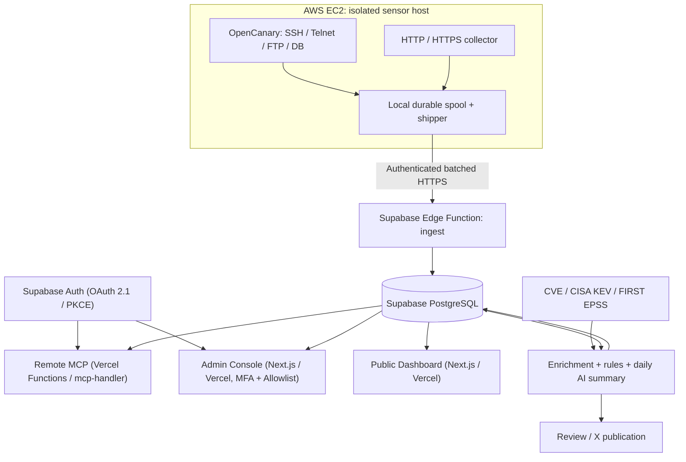

# Attackarium — Honeypot Observatory

A noncommercial attack observatory that captures, stores, and analyzes unsolicited
Internet traffic using OpenCanary and a minimal HTTP/HTTPS collector, enriches
evidence-backed detections with CVE / CISA KEV / FIRST EPSS context, and exposes
sanitized trends via a public Next.js dashboard and a read-only Remote MCP server.

> **Status:** Early implementation / MVP in progress. **No public honeypot is deployed.**
> Local migrations, ingest tests, synthetic dashboard views, and sensor prototypes are under development.

## Goals

- Capture SSH / Telnet / FTP / MySQL / Redis probes using OpenCanary on an isolated AWS EC2 sensor host.
- Capture bounded HTTP / HTTPS scans and requests using a dedicated, non-executing web collector.
- Store historical telemetry and daily rollups in Supabase PostgreSQL with default-deny RLS.
- Enrich deterministic rule detections with NVD (CVE), CISA KEV, and FIRST EPSS context without claiming confirmed exploitation.
- Expose sanitized observations via a public Next.js dashboard and an OAuth 2.1 authenticated, read-only Remote MCP server on Vercel Functions (`mcp-handler`).
- Generate draft daily AI summaries from anonymized aggregates for human review before any X publication.

## Architecture



## Repository layout

```text
apps/web/                    Next.js dashboard (to implement)
AGENTS.md                    Cursor/AI agent repository-wide guardrails
sensors/opencanary/          OpenCanary config and deployment (to implement)
sensors/http-collector/      Minimal HTTP/HTTPS capture sensor (to implement)
sensors/shipper/             Bounded spool and authenticated log shipping (to implement)
supabase/functions/ingest/   Validated ingestion API (to implement)
supabase/migrations/         PostgreSQL schema / RLS / indexes (to implement)
jobs/                        Enrichment, aggregation, reporting (to implement)
infra/                       Infrastructure as code and operations (to implement)
docs/ARCHITECTURE.md         Components, data flow, deployments
docs/IMPLEMENTATION_PLAN.md  MVP scope, milestones, acceptance criteria
docs/CURSOR_SETUP.md         Official Vercel/Supabase Skills for Cursor
docs/DATA_MODEL.md           Tables and data lifecycle
docs/SECURITY.md             Threat model and operational safeguards
docs/DECISIONS.md            Architecture decision log
```

## Next steps

1. Confirm AWS EC2 account/region, instance sizing, spend cap, and abuse-response policy.
2. Complete Phase 1–2 local verification (PostgreSQL/RLS, ingest API, public dashboard, sensors).
3. Implement read-only Remote MCP (Vercel Functions + `mcp-handler` + Supabase Auth OAuth 2.1) and operator-only Admin Console (MFA + allowlist + MCP Usage).
4. Deploy the isolated EC2 sensor only after all security and abuse-response checks pass.
5. Add correlation (CVE/KEV/EPSS), daily reporting, and manually reviewed X publication.

## Documents

- [Implementation plan](docs/IMPLEMENTATION_PLAN.md)
- [Architecture](docs/ARCHITECTURE.md)
- [Data model](docs/DATA_MODEL.md)
- [Security and deployment gates](docs/SECURITY.md)
- [Architecture decisions](docs/DECISIONS.md)
- [Cursor setup and recommended Skills](docs/CURSOR_SETUP.md)

## License

Undecided. Do not assume this repository or its data is licensed for third-party reuse until a license is selected.
